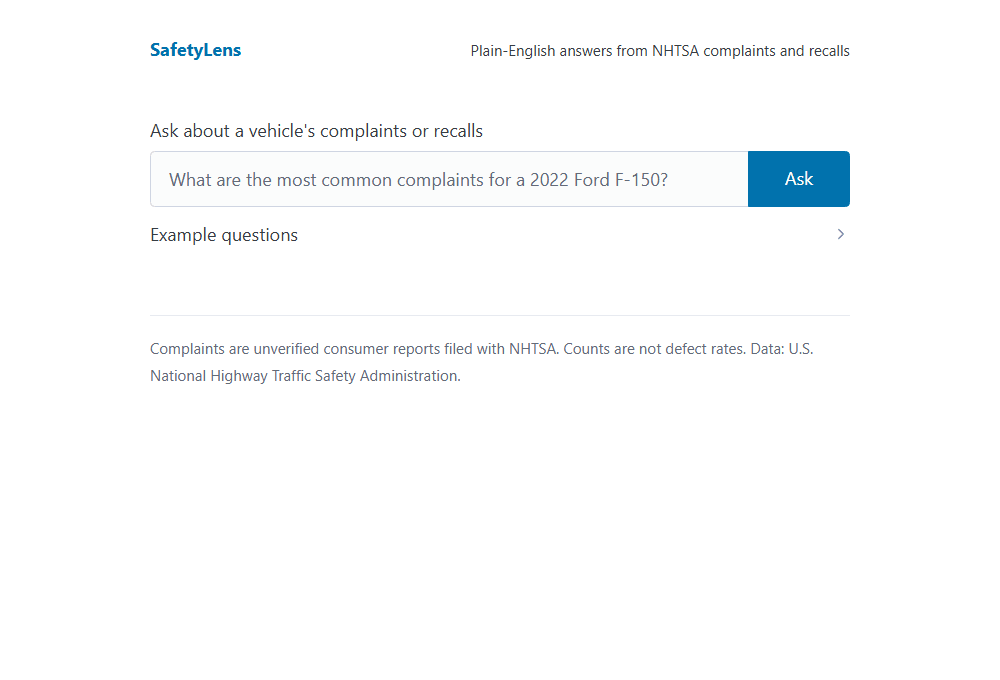
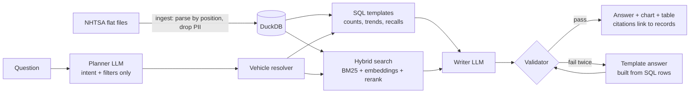

# SafetyLens

Ask plain-English questions about U.S. vehicle safety complaints and recalls, and get answers whose
every number comes from SQL and every claim cites a real NHTSA record.



> Complaints are unverified consumer reports filed with NHTSA. Counts are not defect rates.
> Data: U.S. National Highway Traffic Safety Administration.

SafetyLens is a learning project: a small, fully tested pipeline from public flat files to a cited
answer in the browser. It is not a safety rating, and it never says whether a vehicle is safe or
which one to buy.

## Quickstart

Needs Python 3.12, [uv](https://docs.astral.sh/uv/), `make`, and an Anthropic API key for answers
(record pages and charts work without one).

```bash
uv sync                       # install (CUDA torch on Windows, CPU torch on Linux)
cp .env.example .env          # then set ANTHROPIC_API_KEY, model names and daily budgets
make data-dev                 # download 2020-2026 complaints + post-2010 recalls, build, index
make serve                    # http://127.0.0.1:8000
```

`make data-dev` downloads about 130 MB and builds a 1.5 GB DuckDB file under `data/` (git-ignored).
Indexing embeds ~430,000 complaints: about 10 minutes on a GPU, much longer on a CPU.

Other entry points: `uv run safetylens ask "What are the most common complaints for a 2022 Ford
F-150?"`, `uv run safetylens search ...`, `uv run safetylens --help`.

Docker (the app only; data is built on the host and mounted):

```bash
docker build -t safetylens .
docker run --rm -p 8000:8000 --env-file .env -v "$PWD/data:/app/data" safetylens
```

## How it works



1. **Ingest** (`src/safetylens/ingest/`): downloads with checksums and `If-None-Match`, parses the
   tab-delimited files by field position, drops personal fields, loads Parquet into DuckDB.
2. **Build** (`src/safetylens/store/`): one row per complaint × component, one row per complaint for
   search, recalls per campaign × vehicle × component, a model alias table.
3. **Analytics** (`src/safetylens/analytics/`): parameterized SQL templates; complaints are counted
   with `COUNT(DISTINCT odino)` because a complaint repeats once per component.
4. **Search** (`src/safetylens/search/`): DuckDB full-text BM25 and `bge-small-en-v1.5` embeddings,
   fused with reciprocal rank fusion and reranked by a cross-encoder.
5. **Answer** (`src/safetylens/answer/`): the planner picks an intent and filters (never SQL), the
   resolver maps "F150 pickup" to a model, SQL and search run, the writer drafts, the validator checks,
   and verified answers are cached by their normalized plan.
6. **Web** (`src/safetylens/web/`): FastAPI + Jinja2 + HTMX + Pico.css, Altair charts, record pages
   for every complaint, recall and vehicle.

## How answers stay honest

- **Numbers come from SQL, words come from records.** Every number, date and number word in an answer
  must appear in the SQL rows the writer was given, or the draft is rejected.
- **Only cite what was retrieved.** Every `[ODI]` or campaign id must be in the evidence set and exist
  in the database; only those become links.
- **No model-written SQL.** The planner fills a typed plan; queries are fixed `.sql` templates with
  bound parameters.
- **A safe fallback.** A draft that fails twice is replaced by a template answer built from the rows,
  which is validated too. Out-of-scope questions (safety verdicts, buying advice) get a fixed refusal.
- **Budgets.** Daily spending caps are checked before every API call; the ledger holds no prompts.

## Data card

| | |
|---|---|
| Source | [NHTSA datasets and APIs](https://www.nhtsa.gov/nhtsa-datasets-and-apis): complaint flat files (`COMPLAINTS_RECEIVED_*.zip`) and recall flat files (`FLAT_RCL_POST_2010.zip`); free, keyless, updated daily |
| Dev slice | complaints received 2020-2026, recalls since 2010 (`make data-full` loads everything) |
| Size (dev slice) | 625,137 complaint rows; 430,187 distinct complaints (ODI numbers); 428,507 vehicle complaints searchable; 15,332 recall campaigns; 109,237 recall × vehicle × component rows |
| Grain | `complaints`: complaint × component; `complaint_docs`: one row per complaint; `recalls`: campaign × vehicle × component |
| Dropped at ingest | VIN, city, dealer name/phone/address, vehicle operator: they never reach the database, prompts, logs or pages |
| Checks | `make dq`: no missing ODI, no duplicate complaint/component rows, PII columns absent; `make crosscheck`: distinct complaint counts for 10 vehicles match the live NHTSA API (10/10, 0.00% max difference) |
| Known gotchas | an ODI repeats per component; model names vary (`F-150`, `F150`, `F-150 PICKUP`); model year 9999 means unknown; miles and speed 0 mean unknown; older files are cp1252, newer UTF-8 |
| What it is not | complaints are unverified and self-reported; counts depend on how many owners file, not on how many vehicles fail, so they are not defect rates |
| License | U.S. government data, public domain; attribution: U.S. National Highway Traffic Safety Administration |

## Results

<!-- eval-table:start -->
From `evals/reports/answers-2026-10-22.md` and `evals/reports/retrieval-2026-10-22.md`.

| | Check | Target | Latest | Status |
|---|---|---|---|---|
| D5 | Numbers grounded in SQL | 100% | 100% | pass |
| D6 | Citations valid | 100% | 100% | pass |
| D7 | Citations support the claim (LLM judge) | >= 90% | 97% | pass |
| D8 | Retrieval recall@10 (test split) | >= 0.80 | 0.777 | accepted miss |
| D9 | Golden questions pass (of 40) | >= 85% | 88% | pass |
| D9 | Out-of-scope questions refused | all | 6/6 | pass |
| D12 | Latency p95 (p50) | < 8 s | 8.1 s (4.7 s) | accepted miss |
| D13 | Mean cost per question | reported | $0.0110 | pass |
<!-- eval-table:end -->

Other checks: `make dq` passes, `make crosscheck` matches NHTSA for 10/10 vehicles, ingest is
idempotent (identical row counts and checksums on a second run), `make e2e` drives a real browser
through question → answer → citation → record page → NHTSA link. Accepted misses are listed with the
owner's reasoning in [evals/accepted_misses.yaml](evals/accepted_misses.yaml).

## Limitations

- **Complaints are unverified.** A spike can come from news coverage or a recall notice, not a defect.
- **Counts are not rates.** Popular vehicles get more complaints; nothing here is normalized by sales.
- **Dev slice only by default**: complaints received since 2020. Older complaints need `make data-full`.
- **Latency:** most answers take about 5 s, but the slowest 5% take 8-10 s (two model calls plus API
  variance). Repeated questions come from the cache.
- **Retrieval:** about 3 in 4 relevant complaints show up in the top 10 search results (recall@10
  0.78), below the 0.80 target.
- **The LLM judge is not ground truth.** Citation support (D7) is judged by a model and spot-checked by
  hand; the validator guarantees numbers and ids, not that every sentence is well supported.
- **Single user, localhost.** No authentication; one answer is written at a time.

## Costs

Answers use a small planner model and a larger writer model (names are set in `.env`). The latest eval
measured about $0.012 per question, plus about $0.39 for the LLM judge per 40-question eval run.
Separate daily caps for `ask`/`serve` (`SAFETYLENS_DAILY_BUDGET_USD`) and `eval`
(`SAFETYLENS_EVAL_BUDGET_USD`) are checked before every call; at the cap the app says so instead of
calling the API. Cached answers cost only the planner call.

## Development

```bash
make check        # ruff, format, mypy --strict, pytest with coverage >= 80% (no network, no API)
make e2e          # Playwright browser test with a scripted fake LLM
make dq           # data-quality report
make crosscheck   # compare counts with the live NHTSA API
make eval-retrieval
make eval         # 40 golden questions with the real API (costs about $1)
make docs         # README sections, links, GIF, and results table vs the latest reports
make acceptance   # everything above on a fresh clone (scripts/fresh_clone_check.sh)
```

Project rules live in [CLAUDE.md](CLAUDE.md), the plan in [docs/PLAN.md](docs/PLAN.md), progress in
[docs/PROGRESS.md](docs/PROGRESS.md), and what was learned along the way in
[docs/LEARNING.md](docs/LEARNING.md).
